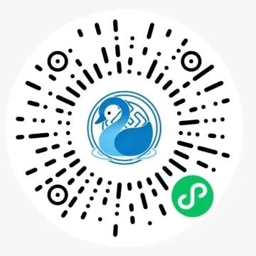
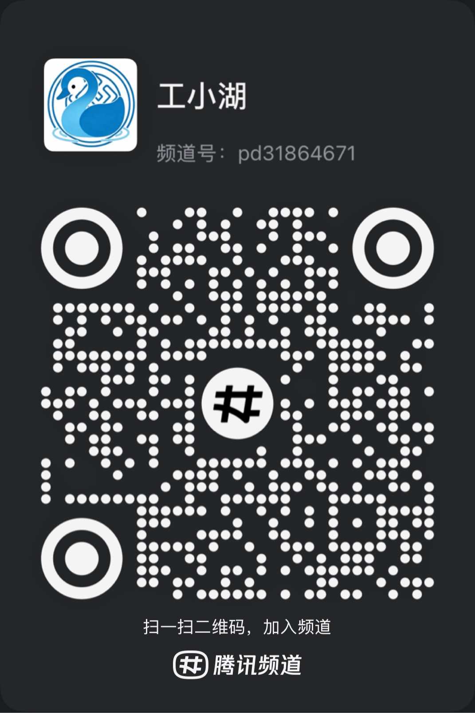
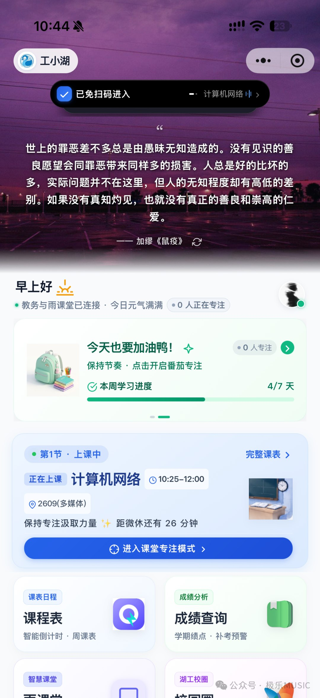
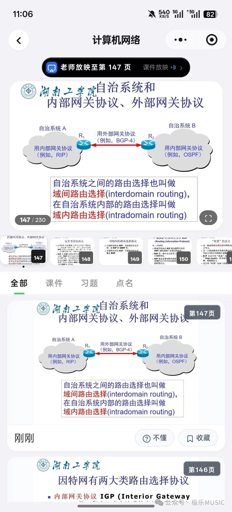
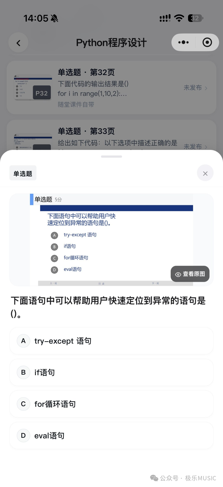
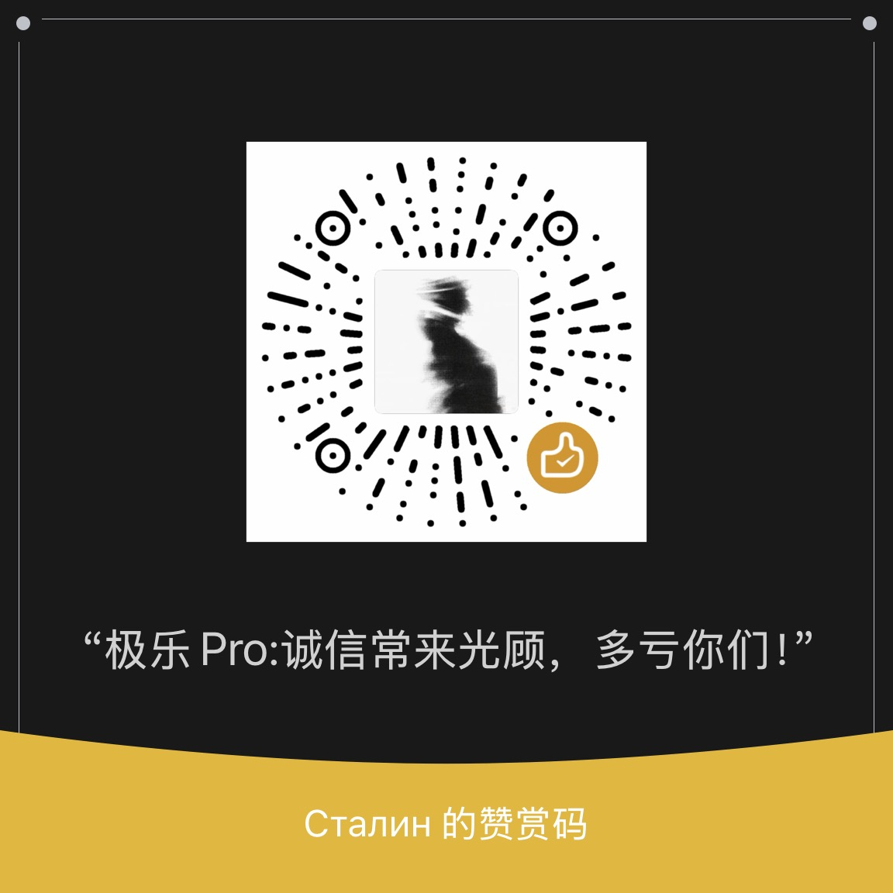

# 工小湖 (GongXiaoHu)

> 专为早八人写的雨课堂增强工具与校园助手。

[-emerald)](https://pan.quark.cn/s/236c3ee4c001)
[](#-客户端支持与下载)
[](LICENSE)
[](#-关于开源进度)

[在线体验（扫码体验）](#-在线体验微信小程序) · [页面截图](#-页面截图) · [安卓端下载（夸克网盘）](https://pan.quark.cn/s/236c3ee4c001) · [开发博客原理](https://blog.jiclub.site/2026/yuketang-deep-dive) · [QQ 频道](#-qq-频道) · [捐赠支持](#-捐赠支持)

---

## 📱 在线体验（微信小程序）

微信扫一扫下方小程序码，即可免安装直接体验工小湖功能：

<div align="center">
  
  <p><sub>微信扫一扫，立即体验小程序</sub></p>
</div>

---

## 💬 QQ 频道

欢迎加入工小湖 QQ 频道，获取项目动态、交流使用体验，并反馈问题与建议。

<div align="center">
  
  <p><sub>使用 QQ 扫描二维码，加入频道</sub></p>
</div>

---

## 为什么写这个项目？

平时在阶梯教室上课，经常被这几件事折磨：

- **坐后排扫码根本扫不上**：大教室离黑板大屏几十米远，雨课堂动态码闪得又快，举着手机拉长焦对半天进不去班；
- **倒计时一到答案全清空**：随堂计算题刚写完，倒计时一到网页直接弹锁死遮罩，辛苦敲的草稿瞬间没了；
- **一发题就挡住课件**：老师随堂推题，题目遮罩整个屏幕，想看着 PPT 板书做题根本看不到；
- **切后台直接离线断联**：中途切出去回个消息，后台断连，切回来又得重新进班。

受够了这些痛点，干脆自己抓包分析了雨课堂协议，写了这套更顺手的轻量客户端。

---

## 主要功能

- 🚀 **免扫码秒进班**：开课自动检测进入，支持手机短信验证码登录，告别举手机长焦对大屏。
- 📝 **超时补答与草稿防丢**：主观题答案与草稿实时存本地。倒计时结束也能继续补交，支持上传演算草稿图。
- 📖 **课件与题目分栏**：做随堂题不再挡住正在讲的 PPT，弹窗点选一键交卷，边看课件边做题。
- 💡 **后台保活不掉线**：优化了心跳与轮询通道，切屏查资料或熄屏不会轻易掉线。
- 🛠️ **服务与网络诊断**：内置多节点与网络链路实时测速排查，快速定位课堂网络问题。

---

## 📸 页面截图

| 免扫码秒进班 | 百页课件流式翻阅 |
| :---: | :---: |
|  |  |
| **课件习题分栏 / 弹窗秒交** | **超时补答与演算草稿防丢** |
|  |  |

---

## 📦 客户端支持与下载

| 平台 | 当前状态 | 获取方式 |
| :--- | :--- | :--- |
| **Android 客户端** | **v2.1.0 稳定版（15 MB）** | [点击前往夸克网盘极速下载](https://pan.quark.cn/s/236c3ee4c001) |
| **微信小程序** | **在线体验中** | 扫描上方小程序码直接使用 |
| **iOS 客户端** | **正在开发构建中** | iOS 用户当前推荐先扫码使用微信小程序 |
| **官网** | 获取资源 | [点击访问项目](https://ykt.jiclub.site/) |

---

## ❤️ 捐赠支持

工小湖是个人业余开发项目。如果它对你的学习或日常使用有所帮助，欢迎通过下方二维码自愿支持项目的持续维护与开发。感谢每一份鼓励！

<div align="center">
  
  <p><sub>扫码自愿支持工小湖</sub></p>
</div>

---

## 🔒 关于开源进度

- **核心源码后续待开源**：目前本仓库主要开源托管 **Web 官网展示页与多端交互演示代码**。
- 雨课堂协议底层解析、自动化打卡及客户端核心实现源码，正在整理脱敏中，后续会逐步开放。

---

## 本地启动与构建

本项目官网与交互演示基于 React + Vite + Tailwind CSS 构建：

```bash
# 安装依赖
pnpm install

# 启动本地开发服务
pnpm dev

# 打包生产静态资源
pnpm build
```

---

## 声明

- 本项目为个人业余兴趣开发，仅供计算机网络协议学习与前端交互研究使用。
- 账号凭据均保存在本地客户端，无任何第三方服务器收集学生个人隐私。

## 许可证

[MIT License](LICENSE)
